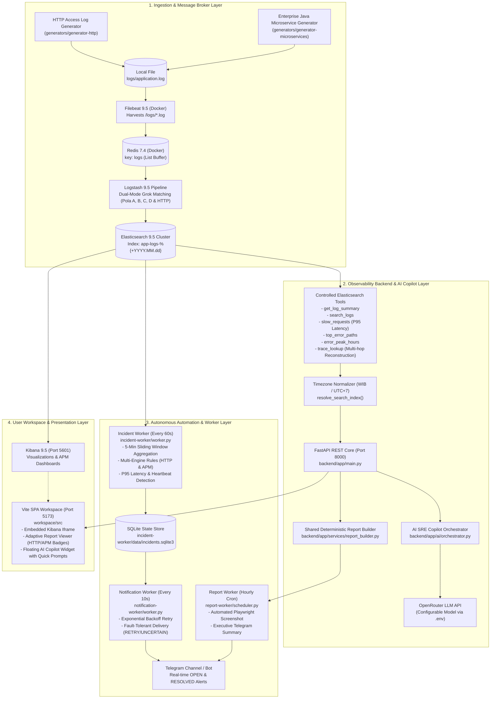

# 🚀 AI-Enhanced Centralized Log Observability Platform (Dual-Mode Engine)

[](https://www.python.org/)
[](https://fastapi.tiangolo.com/)
[](https://www.elastic.co/)
[](https://www.elastic.co/kibana)
[](https://redis.io/)
[](https://openrouter.ai/)
[](https://vitejs.dev/)
[](https://www.docker.com/)

Platform pemantauan log terpusat dan observabilitas cerdas (*Dual-Mode Observability*) berstandar industri. Platform ini mengintegrasikan **ELK Stack (Elasticsearch 9, Logstash, Kibana)** dengan buffer **Redis**, backend **FastAPI**, agen **AI SRE Copilot via OpenRouter API**, serta rangkaian worker otomatis untuk **Deteksi Insiden**, **Notifikasi Telegram Real-Time**, dan **Laporan Eksekutif Berkala (disertai screenshot dashboard otomatis via Playwright)**.

Mendukung **Dual-Mode Schema Engine**:
1. **HTTP Web Access Log** (Apache/Nginx: `status_code`, `request_path`, `response_time`).
2. **Distributed Java Microservices APM & Tracing** (`trace_id`, `service_name`, `step_name`, `duration_ms`, `perf_action`, `log_level`, parameter input bisnis, dan *exception stacktraces*).

---

## 🏛️ Arsitektur Sistem



---

## 📂 Struktur Repositori & Progress Folder

```text
elk-stack/
├── docker-compose.yml              # Definisi Cluster Docker: Elasticsearch, Kibana, Redis, Logstash, Filebeat
├── verify_phase5_e2e.py            # Automated End-to-End System Smoke Test (7/7 Test Suites)
├── logs/                           # Folder shared volume penyimpanan file log (/logs/application.log)
│
├── backend/                        # FastAPI REST API & AI Copilot Core
│   ├── app/
│   │   ├── ai/                     # AI Orchestrator, SRE System Prompt, OpenAPI Tool Definitions & Executor
│   │   ├── api/                    # REST Router: /api/ai/chat, /api/reports/summary, /api/system/health
│   │   ├── services/               # Shared Report Builder & OpenRouter LLM Client
│   │   ├── tools/                  # Controlled ES Query Tools (trace_lookup, summary, slow_requests, validators)
│   │   ├── config.py               # Pydantic Settings (OpenRouter API Key, Index Allowlist, Timeouts)
│   │   ├── es_client.py            # Singleton Elasticsearch Client Connection
│   │   └── main.py                 # FastAPI Application Entrypoint (CORS, Lifespan, Routers)
│   ├── requirements.txt            # Dependensi Python Backend
│   └── .env                        # Konfigurasi Backend & OpenRouter API Key
│
├── incident-worker/                # Engine Deteksi Anomali & Manajemen Insiden
│   ├── data/incidents.sqlite3      # Database SQLite untuk State Tracking, Riwayat Insiden & Event OPEN/RESOLVED
│   ├── endpoint_detector.py        # Detektor Endpoint / Service Error Berulang (Repeated Failure)
│   ├── latency_detector.py         # Detektor Degradasi Latensi P95 (Durasi Eksekusi > 4000 ms)
│   ├── stale_detector.py           # Heartbeat Detector: Mendeteksi aliran log berhenti (Silent Outage)
│   ├── incident_store.py           # State Machine Insiden & Konfirmasi Normal Berurutan
│   ├── rules.py                    # Multi-Engine Rule Definitions & Evaluator (Dual-Mode HTTP & APM)
│   ├── worker.py                   # Continuous Polling Loop (Default: setiap 60 detik)
│   └── .env                        # Ambang Batas (Threshold) Evaluasi Insiden
│
├── notification-worker/            # Worker Notifikasi Alert Telegram
│   ├── state/notifications.sqlite3 # Database SQLite pencatat status pengiriman (SENT, RETRY, UNCERTAIN)
│   ├── telegram_client.py          # HTTP Client Telegram Bot API (GET/POST)
│   ├── worker.py                   # Worker pengirim notifikasi dengan Exponential Backoff & Flag --retry-uncertain
│   └── .env                        # Telegram Bot Token & Chat ID
│
├── report-worker/                  # Worker Laporan Kesehatan Sistem Berkala
│   ├── state/reports.sqlite3       # Database SQLite tracking riwayat laporan berkala
│   ├── scheduler.py                # Cron Scheduler Pembuat Laporan Tiap Jam
│   ├── screenshot.py               # Headless Playwright/Chromium untuk screenshot otomatis Dashboard Kibana
│   ├── telegram_sender.py          # Formatter Markdown Laporan Eksekutif & Pengirim Gambar ke Telegram
│   ├── worker.py                   # Eksekusi pembuatan laporan tunggal (Standalone Run)
│   └── .env                        # Konfigurasi URL Kibana, Jadwal Cron & Telegram
│
├── workspace/                      # Frontend SPA Modern (Vite + Dark Mode Theme)
│   ├── src/
│   │   ├── floating-ai/            # Komponen Floating Chat AI Copilot & Quick Suggestion Action Pills
│   │   ├── main.js                 # Workspace Controller, Iframe Bridge & Adaptive Report Renderer
│   │   └── style.css               # Styling Glassmorphism Modern Dark Theme
│   ├── index.html                  # Container Dashboard Kibana Terintegrasi
│   └── package.json                # Script Vite & Frontend Manifest
│
├── generators/                     # Generator Log Sintetis Skala Industri
│   ├── generator-http/             # Generator Log Akses HTTP Apache (Status Code 200 s/d 500)
│   │   ├── generator_endPoint.py   # HTTP Endpoint traffic generator
│   │   └── generator_endpoint_rt.py# Real-time HTTP log generator
│   └── generator-microservices/    # Enterprise Java Microservices Distributed Log Generator
│       ├── log_generator.py        # 9 Microservices, 5 Distributed Workflows, Multi-span, 10 Scenarios
│       ├── worker.py               # Alias runner kompatibel
│       └── README.md               # Dokumentasi lengkap opsi skenario generator
│
├── logstash/pipeline/logstash.conf # Pipeline Logstash: Redis Input, Dual-Mode Grok, Date Parse, ES Output
└── filebeat/filebeat.yml           # Konfigurasi Filestream Ingestion Filebeat -> Redis
```

---

## 🌟 Fitur Utama Platform

### 1. Dual-Mode Schema Auto-Detection
Backend secara otomatis mengidentifikasi karakteristik data log yang sedang diobservasi:
- **`http_access`**: Menganalisis status HTTP (`2xx`, `3xx`, `4xx`, `5xx`), pemisahan *Technical 4xx vs Business 4xx*, serta response time gateway.
- **`microservice_tracing`**: Menganalisis log level (`DEBUG`, `INFO`, `WARN`, `ERROR`), eksekusi step bertingkat, dan durasi eksekusi riil via field numerik `duration_ms` (pada event `perf_action: "End"`).
- **`hybrid`**: Menampilkan metrik HTTP dan Microservice berdampingan dalam satu jendela observabilitas tanpa konflik schema.

### 2. Timezone-Aware Index Resolution (WIB / UTC+7 Alignment)
Logstash mempartisi index berdasarkan waktu UTC (`app-logs-%{+YYYY.MM.dd}`). Karena zona waktu bisnis di Indonesia adalah **WIB (UTC+7)**, sistem mengimplementasikan modul `resolve_search_index()` di backend:
- Permintaan analitik 1 hari penuh WIB (`00:00:00` s/d `23:59:59 WIB`) otomatis dialihkan ke pattern wildcard `app-logs-*` yang difilter dengan rentang `@timestamp` yang tepat.
- Menjamin data jam `00:00–07:00 WIB` (yang tersimpan di shard UTC hari sebelumnya) dan data jam `07:00–24:00 WIB` ditarik utuh, **sinkron 100% dengan apa yang ditampilkan di Kibana Discover**.

### 3. Distributed Trace Lookup & Timeline Reconstruction
Tool `trace_lookup` memungkinkan engineer melacak satu transaksi bisnis perbankan secara menyeluruh hanya dengan memasukkan `trace_id`:
- Mengambil seluruh span dari berbagai microservice yang berkolaborasi secara kronologis (`@timestamp ASC`).
- Menghitung total durasi transaksi, durasi setiap langkah (`step_name`), variabel bisnis (`cifNumber`, `corpId`, `amount`, `currency`, `routingCode`), hingga pinpoint baris exception/error penyebab kegagalan.

### 4. Autonomous Multi-Engine Incident Worker
Berjalan di background setiap 60 detik mengevaluasi jendela data 5 menit terakhir:
- **`HIGH_ERROR_LOG_RATE`** *(Microservice APM)*: Terpicu jika rasio log `ERROR` terhadap total APM $\ge 5.0\%$ (minimal 10 error).
- **`HIGH_5XX_ERROR_RATE` & `HIGH_4XX_ERROR_RATE`** *(HTTP Access)*: Otomatis berstatus `NOT_APPLICABLE` jika log yang diproses adalah microservice (mencegah *false alarms*).
- **`REPEATED_ERROR_ENDPOINT`**: Mendeteksi URL HTTP yang sering gagal ATAU microservice (`service_name -> step_name`) yang gagal berulang $\ge 10$ kali.
- **`HIGH_RESPONSE_TIME`**: Mengukur **Percentile 95 (P95 Latency)** pada `perf_action: "End"` ($\ge 4000\text{ ms}$).
- **`STALE_NO_LOG`**: Memantau heartbeat data ingestion (alert jika tidak ada log baru masuk $> 10$ menit).
- **Incident Lifecycle**: Menyimpan status `OPEN` dan `RESOLVED` ke database SQLite dengan konfirmasi normal berurutan sebelum insiden ditutup otomatis.

### 5. Fault-Tolerant Telegram Alerts & Hourly Report Worker
- **Notification Worker**: Mengirimkan alert insiden real-time ke Telegram dengan format Markdown terstruktur. Dilengkapi strategi retry *exponential backoff* dan klasifikasi status pengiriman:
  - `SENT`: Berhasil terkirim (HTTP 200).
  - `RETRY`: Kegagalan sementara (Rate Limit 429, ConnectionError, DNS drop, ConnectTimeout).
  - `UNCERTAIN`: Response timeout / koneksi terputus di tengah jalan. Sekarang otomatis dicoba ulang hingga `MAX_ATTEMPTS` atau di-reset instan via `python3 worker.py --retry-uncertain`.
  - `FAILED_FINAL`: Error permanen (Token bot / Chat ID salah).
- **Report Worker**: Menghasilkan ringkasan kesehatan sistem setiap jam, memanggil Playwright headless browser untuk mengambil screenshot aktual Dashboard Kibana, dan mengirimkannya ke Telegram.

### 6. AI SRE Copilot (Powered by OpenRouter API)
Backend mengintegrasikan LLM via **OpenRouter API** dengan kapabilitas *Agentic Tool Calling*:
- Agent AI tidak hanya menjawab teks biasa, tetapi secara otonom memanggil tools query ke Elasticsearch (`trace_lookup`, `get_log_summary`, `search_logs`, `slow_requests`, dll.).
- Menganalisis *root cause* insiden, menemukan bottleneck layanan, dan memberikan rekomendasi teknis perbaikan sistem kepada engineer.

---

## ⚙️ Panduan Konfigurasi (`.env`)

### 1. Root & Backend Environment (`backend/.env` atau root `.env`)
```env
ELASTICSEARCH_URL=http://localhost:9200
ELASTICSEARCH_INDEX_ALLOWLIST=app-logs-*
TOOL_MAX_RESULTS=100
TOOL_MAX_LOOKBACK_HOURS=168

# OpenRouter AI LLM Configuration
OPENROUTER_API_KEY=your_openrouter_api_key_here
LLM_PROVIDER=openrouter
LLM_MODEL=openrouter/free
OPENROUTER_BASE_URL=https://openrouter.ai/api/v1
LLM_TIMEOUT_SECONDS=120
LLM_MAX_RETRIES=2
LLM_RETRY_BASE_SECONDS=1.0
```

### 2. Incident Worker (`incident-worker/.env`)
```env
ELASTICSEARCH_URL=http://localhost:9200
INCIDENT_INDEX=app-logs-*
POLL_INTERVAL_SECONDS=60
WINDOW_MINUTES=5

# HTTP Rules Threshold
INCIDENT_MIN_TOTAL_REQUESTS=100
INCIDENT_5XX_RATE_THRESHOLD_PERCENT=5.0
INCIDENT_5XX_MIN_ERRORS=10
INCIDENT_4XX_RATE_THRESHOLD_PERCENT=20.0
INCIDENT_4XX_MIN_ERRORS=30

# Microservice APM Rules Threshold
INCIDENT_APM_MIN_TOTAL_EVENTS=50
INCIDENT_APM_ERROR_RATE_THRESHOLD_PERCENT=5.0
INCIDENT_APM_MIN_ERRORS=10

# Latency & Repeated Errors
INCIDENT_REPEATED_MIN_ERRORS=10
INCIDENT_LATENCY_THRESHOLD_MS=4000
INCIDENT_LATENCY_MIN_SAMPLES=100
INCIDENT_LATENCY_MIN_SLOW_REQUESTS=10

# Lifecycle & Stale Detection
INCIDENT_RESOLVE_CONFIRMATIONS=2
INCIDENT_EXPECT_LOGS=false
INCIDENT_STALE_AFTER_SECONDS=600
```

### 3. Notification Worker (`notification-worker/.env`)
```env
TELEGRAM_BOT_TOKEN=your_telegram_bot_token
TELEGRAM_CHAT_ID=your_telegram_chat_id
INCIDENT_DB_PATH=../incident-worker/data/incidents.sqlite3
NOTIFICATION_DB_PATH=state/notifications.sqlite3
NOTIFICATION_POLL_SECONDS=10
NOTIFICATION_RETRY_SECONDS=60
NOTIFICATION_MAX_ATTEMPTS=5
NOTIFICATION_RETRY_UNCERTAIN=true
```

### 4. Report Worker (`report-worker/.env`)
```env
TELEGRAM_BOT_TOKEN=your_telegram_bot_token
TELEGRAM_CHAT_ID=your_telegram_chat_id
BACKEND_BASE_URL=http://localhost:8000
KIBANA_DASHBOARD_URL=http://localhost:5601/app/dashboards
REPORT_INTERVAL_HOURS=1
```

---

## 🚀 Panduan Menjalankan Sistem

### 1. Menjalankan Infrastruktur Docker (ELK Cluster + Redis)
```bash
# Pastikan Docker Desktop / daemon aktif
docker compose up -d elasticsearch redis logstash kibana filebeat
```
Verifikasi port layanan:
- **Elasticsearch**: `http://localhost:9200`
- **Kibana Web UI**: `http://localhost:5601`
- **Logstash API**: `http://localhost:9600`
- **Redis CLI**: `localhost:6379`

### 2. Menjalankan FastAPI Backend
```bash
cd backend
python3 -m venv .venv
source .venv/bin/activate
pip install -r requirements.txt

# Jalankan server API
uvicorn app.main:app --host 0.0.0.0 --port 8000 --reload
```
Akses Swagger UI API: `http://localhost:8000/docs`

### 3. Menjalankan Frontend Workspace SPA
```bash
cd workspace
npm install
npm run dev -- --host
```
Akses Workspace Portal: `http://localhost:5173`

### 4. Menjalankan Background Automation Workers
Buka terminal terpisah untuk masing-masing worker:

```bash
# A. Incident Detection Worker (Mengevaluasi anomali tiap 60s)
cd incident-worker
python3 worker.py

# B. Notification Worker (Mendistribusikan alert ke Telegram tiap 10s)
cd notification-worker
python3 worker.py

# (Opsional) Memaksa pengiriman ulang antrean UNCERTAIN yang tertahan:
python3 worker.py --retry-uncertain --once

# C. Report Worker (Menjadwalkan laporan eksekutif berkala)
cd report-worker
python3 scheduler.py
```

### 5. Menjalankan Log Generator (Simulasi Lalu Lintas Data)

```bash
# A. Generator Log Microservices Skala Industri (9 Services, 5 Workflows)
cd generators/generator-microservices

# Simulasi realistis (92% normal, 5% slow, 3% exceptions):
python3 log_generator.py --count 10 --mode realistic

# Simulasi streaming real-time baris-per-baris:
python3 log_generator.py --stream --interval 0.5

# Simulasi skenario insiden (Core banking timeout / High Error Rate):
python3 log_generator.py --count 15 --mode core_timeout
python3 log_generator.py --count 15 --mode high_error_rate

# B. Generator Log HTTP Web Access
cd generators/generator-http
python3 generator_endPoint.py
```

---

## 🧪 Verifikasi Sistem & Smoke Test

Platform ini dilengkapi rangkaian pengujian *End-to-End Smoke Test* otomatis untuk memvalidasi integritas data, normalisasi waktu, AI tools, dan koneksi Elasticsearch:

```bash
backend/.venv/bin/python3 verify_phase5_e2e.py
```

**Hasil Verifikasi (7/7 Suites Berhasil):**
```text
=================================================================
🚀 STARTING PHASE 5.3 END-TO-END SYSTEM SMOKE TEST
=================================================================

[TEST 1] Report Builder Contract & Data Mapping...
  ✓ Microservice top paths mapped correctly with steps
  ✓ Microservice slow requests mapped with duration_ms and trace_id

[TEST 2] AI Copilot Tool Executor & Trace Lookup...
  ✓ trace_lookup registered in TOOLS_SCHEMA
  ✓ execute_tool('trace_lookup') executed cleanly and returned valid dictionary

[TEST 3] Incident Worker Hybrid Rules Engine...
  ✓ HTTP 5xx Rule correctly bypassed (NOT_APPLICABLE) for Microservice APM logs
  ✓ APM Error Log Rate evaluated: 5.0% (Status: TRIGGERED)

[TEST 4] Notification Worker Telegram Alert Formatting...
  ✓ APM Repeated Error Alert rendered with Service, Steps, and Counts
  ✓ Legacy HTTP 5xx Alert rendered with 100% backward compatibility

[TEST 5] Report Worker Telegram Hourly Summary Formatting...
  ✓ APM Hourly Report formatted with full APM schema and trace details

[TEST 6] Automatic WIB (UTC+7) Timezone Normalization...
  ✓ UTC '2026-10-15T15:55:34.874Z' successfully converted to WIB: '2026-10-15 22:55:34 WIB'

[TEST 7] Live Elasticsearch Query Validation...
  ✓ Connected to Elasticsearch cluster: 'docker-cluster' (v9.5.3)
  ✓ Found active log indices: ['app-logs-2026.09.12', 'app-logs-2026.09.13', ...]
  ✓ Live trace_lookup succeeded for trace '590970427': 129 events found, start=2026-10-15 22:55:34 WIB

=================================================================
🎉 ALL END-TO-END SMOKE TESTS PASSED (7/7 SUITES SUCCESSFUL)!
=================================================================
```

---

## 📜 Lisensi & Kontributor

Dikembangkan sebagai platform observabilitas *enterprise-grade* untuk monitoring distributed microservices, manajemen insiden otomatis, dan analisis akar masalah berbasis Generative AI.
